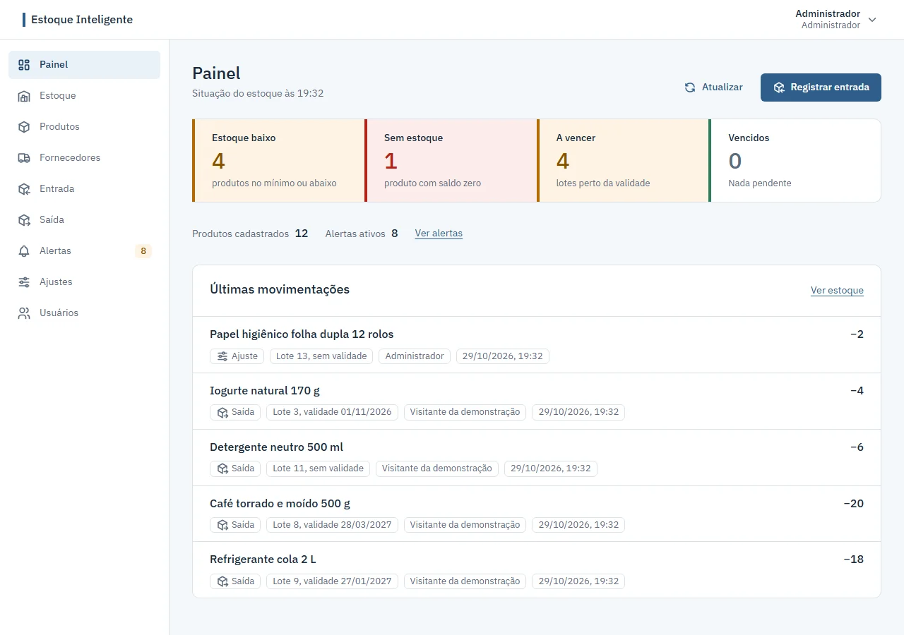
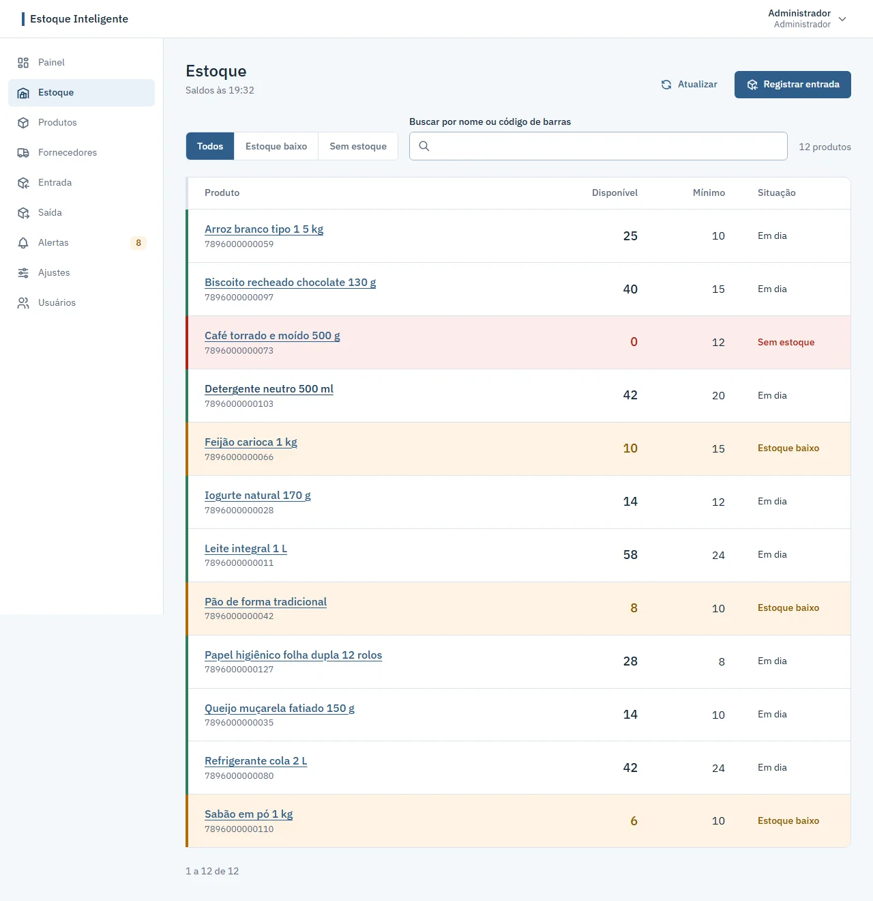
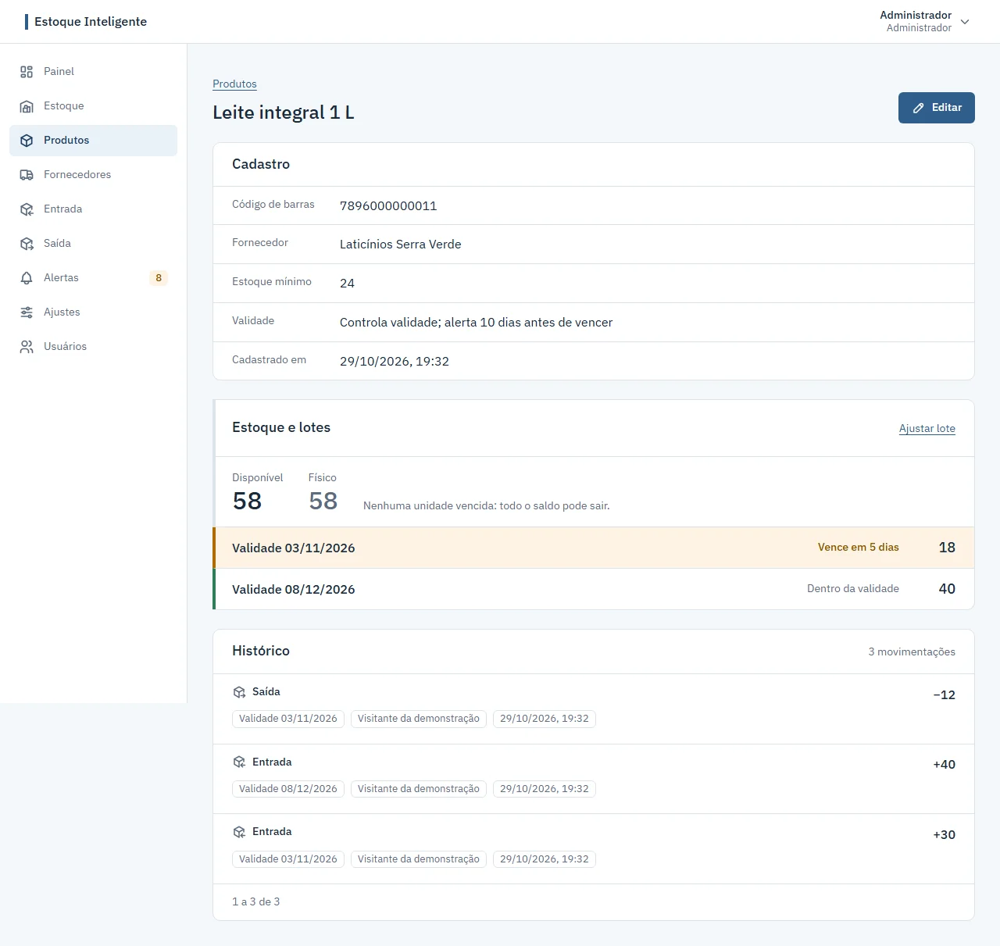
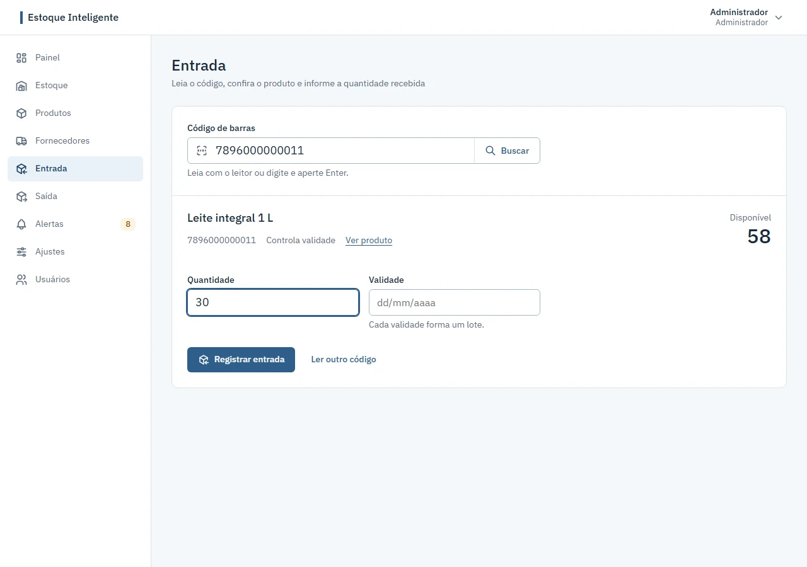
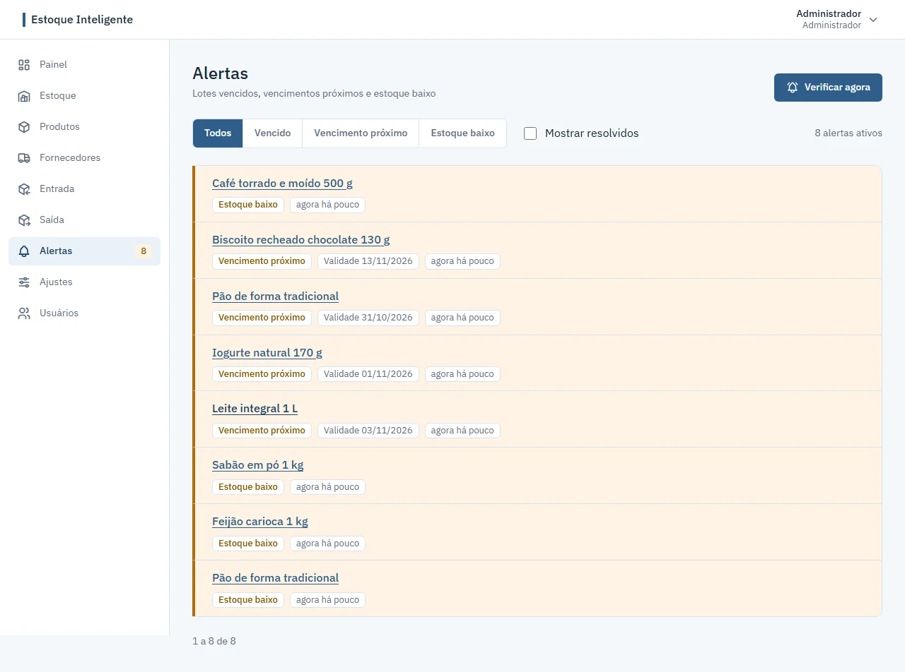
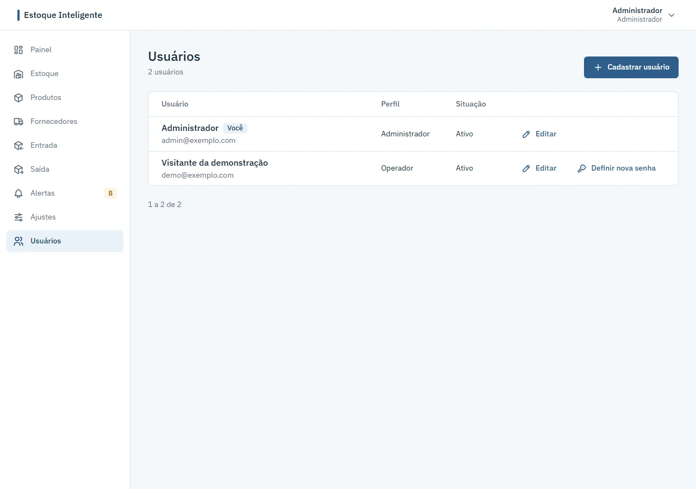
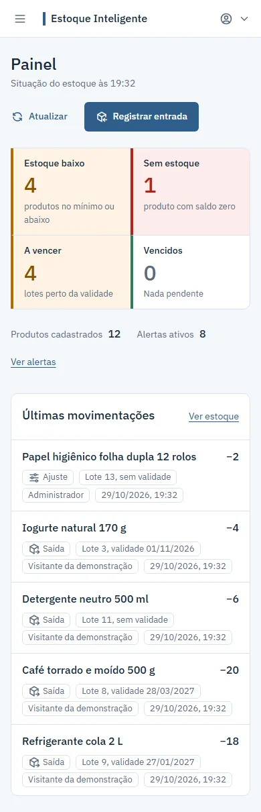
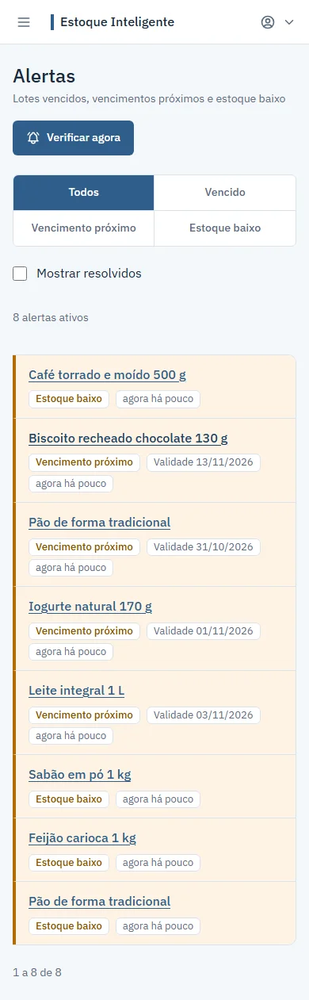

# Estoque Inteligente

Sistema web de controle de estoque com lotes e validade, alertas automáticos e dashboard.

## Destaques

- **FEFO:** a saída usa primeiro o lote que vence primeiro, e o saldo nunca fica negativo.
- **Alertas automáticos:** estoque baixo, vencimento próximo e vencido, sem repetição.
- **Dashboard:** a situação do estoque em tempo real.
- **Segurança:** login com JWT, senhas com Argon2, perfis admin e operador, e limite de tentativas de login.
- **Histórico imutável:** nenhuma movimentação pode ser alterada ou apagada, nem pelo próprio sistema.
- **Qualidade:** 295 testes automatizados, entre backend, frontend e ponta a ponta.

## Teste agora

Site: **https://estoque-site-4qap.onrender.com**

Entre com a conta de demonstração (perfil operador):

- E-mail: `demo@estoque-inteligente.com`
- Senha: `Demo-Estoque-2026`

O primeiro acesso pode levar até um minuto: no plano gratuito do Render, a API "dorme" quando fica ociosa e precisa acordar. As telas mostram um estado de carregando enquanto isso. Os dados de demonstração são recriados do zero uma vez por dia.

## Capturas de tela

| Painel | Estoque |
|---|---|
|  |  |

| Detalhe do produto (lotes e histórico) | Entrada pelo código de barras |
|---|---|
|  |  |

| Alertas | Usuários |
|---|---|
|  |  |

No celular (390 px):

| Painel | Alertas |
|---|---|
|  |  |

## Tecnologias

- **Backend**: Python, FastAPI, Uvicorn, SQLAlchemy, Alembic, Psycopg 3, PostgreSQL.
- **Segurança**: Argon2 para o hash de senha e JWT para autenticação.
- **Frontend**: React, TypeScript e CSS, com Vite.
- **Testes**: pytest (backend), Vitest (unidade do frontend) e Playwright (ponta a ponta).
- **Deploy**: Render (API, site e banco em serviços separados, plano gratuito), com Cloudflare à frente.

## Arquitetura e decisões técnicas

**Camadas no backend.** O código é separado por responsabilidade: `routers` só cuidam do HTTP (recebem a requisição e devolvem a resposta), `services` concentram as regras de negócio e as transações, `models` descrevem as tabelas (SQLAlchemy) e `schemas` validam entrada e saída (Pydantic). Nenhuma regra de negócio mora no router.

**As regras também no banco.** Além das validações da aplicação, o PostgreSQL garante as invariantes com *constraints* e *triggers*: o histórico de movimentações não aceita UPDATE nem DELETE, os saldos não ficam negativos e as relações entre produto, lote e movimentação são protegidas. Assim as regras valem mesmo diante de um acesso fora da API.

**Menor privilégio no banco.** A aplicação pode rodar com dois usuários: o *dono* aplica as migrations (DDL) e um *usuário da aplicação* só tem o necessário para ler e gravar dados, sem poder alterar a estrutura. Isso limita o estrago de uma eventual falha na API.

**Concorrência.** Entradas, saídas e ajustes simultâneos sobre o mesmo produto são serializados com travas de linha (`FOR NO KEY UPDATE`) numa ordem fixa de aquisição, evitando *deadlocks* e condições de corrida no saldo. Há testes com duas conexões reais cobrindo esses cenários.

**Limite de login com o IP real.** O login aceita no máximo 10 tentativas por minuto por IP. Atrás do proxy do Render (com a Cloudflare à frente), o IP vem do cabeçalho `True-Client-Ip` (ou `Cf-Connecting-Ip`), definidos pela Cloudflare. O `X-Forwarded-For` é deliberadamente ignorado, porque o proxy apenas acrescenta itens ao que o cliente enviou e ele poderia ser falsificado para ganhar tentativas novas.

**Partida a frio.** No plano gratuito, a API hiberna quando fica ociosa. O frontend trata a primeira resposta lenta com tolerância e estado de carregando, e há um teste específico para esse comportamento.

**Modo de demonstração.** Com `DEMO_MODE` ligado, a API recria todo o banco com dados de exemplo pelas próprias regras (FEFO, lotes, alertas e histórico) uma vez por dia, e a conta de demonstração tem a troca de senha bloqueada. É o que mantém o site público sempre com dados coerentes e sem acúmulo.

## Qualidade

Os números abaixo refletem a suíte atual do projeto:

- **Backend — pytest: 235 testes.** Cobrem as regras de negócio (cada caso de teste `CT-xx` da documentação vira um teste), os *services* e as rotas, autenticação e perfis, segurança HTTP e CORS, paginação, concorrência com conexões reais, permissões do banco, partida a frio e o modo de demonstração.
- **Frontend — Vitest: 50 testes.** Cobrem o cliente de API, a formatação e o fuso das datas (rodam com o computador no fuso de Tóquio para provar que as datas seguem America/Sao_Paulo), a paginação e a página de demonstração.
- **Ponta a ponta — Playwright: 10 testes.** Rodam contra a API e um banco reais (recriado a cada execução), seguindo fluxos completos de cadastro, entrada, saída, ajuste e alertas, além da responsividade das telas.

## Como rodar localmente (Windows)

Pré-requisitos: Python 3.14, Node.js 24 e PostgreSQL instalados.

1. **Banco de dados.** Crie um banco no PostgreSQL (por exemplo, `estoque_inteligente`).

2. **Backend — ambiente e dependências** (dentro de `backend`):
   ```
   py -m venv .venv
   .venv\Scripts\activate
   pip install -r requirements.txt -r requirements-dev.txt
   ```

3. **Variáveis de ambiente.** Copie `backend\.env.example` para `backend\.env` e preencha os valores reais (pelo menos `DATABASE_URL` e `SECRET_KEY`; gere a chave com `py -c "import secrets; print(secrets.token_hex(32))"`).

4. **Migrations e primeiro admin** (dentro de `backend`, com o ambiente ativo):
   ```
   alembic upgrade head
   py -m app.scripts.create_admin
   ```

5. **Rodar a API** (dentro de `backend`):
   ```
   uvicorn app.main:app --reload
   ```

6. **Frontend** (dentro de `frontend`):
   ```
   npm install
   ```
   Crie um arquivo `.env` com `VITE_API_URL=http://localhost:8000` e rode:
   ```
   npm run dev
   ```
   O site abre em http://localhost:5173.

Testes: `pytest` (dentro de `backend`), `npm run test` e `npm run test:e2e` (dentro de `frontend`).

## Limitações conhecidas

- **Banco gratuito com prazo.** O PostgreSQL do plano gratuito do Render expira cerca de 30 dias após a criação; depois disso é preciso recriá-lo. Por isso o ambiente público é de demonstração, não de produção.
- **Partida a frio.** Como a API gratuita hiberna, o primeiro acesso depois de um período ocioso pode levar até um minuto.
- **CNPJ apenas numérico.** O cadastro de fornecedor aceita o CNPJ só com 14 dígitos numéricos. O novo formato alfanumérico da Receita (em uso desde 31/07/2026) ainda não é aceito.

## Como foi desenvolvido

O projeto foi conduzido com o engenheiro definindo a arquitetura, as regras de negócio e as decisões técnicas, e o Claude Code atuando como operador que implementa cada fase sob essas decisões. O repositório traz um `CLAUDE.md` com as regras de trabalho, *skills* que padronizam tarefas recorrentes (criar endpoint, criar migration, montar página do frontend, aplicar as regras de negócio) e agentes de revisão acionados ao longo do caminho:

- **code-reviewer** — revisa o código FastAPI recém-escrito contra as regras e os casos de teste;
- **security-auditor** — audita rotas desprotegidas, segredos, JWT e validação de entrada;
- **ui-reviewer** — revisa as telas do frontend em várias larguras (responsividade, contraste, foco, estados de carregando/erro/vazio).

## Documentação

- [Regras de negócio](docs/regras-negocio.md)
- [Casos de teste](docs/casos-de-teste.md)
- [Modelo de dados](docs/modelo-de-dados.md)
- [Guia de deploy](docs/deploy.md)
